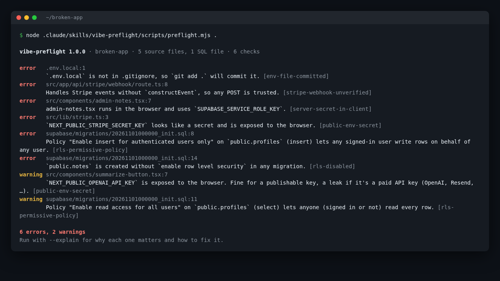

# vibe-preflight

An Agent Skill for Claude Code, Codex and other coding agents that checks a Supabase + Stripe app for six
common launch blockers before you deploy it. It ships with a small Node scanner (one file, no dependencies)
that the agent runs, and instructions telling the agent how to read each finding and fix it.



I built this as a personal project. The checks cover mistakes that are common in Next.js and Vite apps
generated with AI tools: RLS left off, template policies, the service role key in the browser, and Stripe
webhooks that trust any POST.

## Install

```bash
npx skills add atokim4/vibe-preflight
```

Or as a Claude Code plugin (the repo is its own plugin marketplace):

```
/plugin marketplace add atokim4/vibe-preflight
/plugin install vibe-preflight@atokim4-vibe-preflight
```

Then ask your agent something like "run vibe-preflight before we deploy". You can also run the scanner
yourself, with Node 20 or newer:

```bash
node .claude/skills/vibe-preflight/scripts/preflight.mjs path/to/app
```

(the folder depends on the agent you installed the skill for).

## The six checks

| Check | Severity | What it finds |
|---|---|---|
| `rls-disabled` | error | A table in `public` created in a migration with no `enable row level security` anywhere later |
| `rls-permissive-policy` | error on write, warning on read | `using (true)` / `with check (true)` policies |
| `server-secret-in-client` | error | `SUPABASE_SERVICE_ROLE_KEY`, `'service_role'` or a Stripe secret in browser code (`"use client"` files in Next.js, `src/` in Vite/Expo) |
| `public-env-secret` | error / warning | Secret-looking names behind `NEXT_PUBLIC_`, `VITE_` or `EXPO_PUBLIC_` (boolean flags such as `NEXT_PUBLIC_AUTH_PASSWORD=true` are skipped) |
| `stripe-webhook-unverified` | error | A webhook handler that acts on Stripe events without `constructEvent` / `constructEventAsync` |
| `env-file-committed` | error / warning | An `.env*` file with values that git tracks or doesn't ignore. Warning only when it holds just the Supabase CLI's local demo keys or just public variables |

`SKILL.md` explains each one with the fix. The scanner also prints the why and the fix with `--explain`.

## Options

```
-f, --format <text|json>              output format (default: text)
-e, --explain                         add why each finding matters and how to fix it
    --fail-on <error|warning|never>   exit 1 at this level or above (default: error)
    --skip <rule,rule>                turn checks off for this run
    --list                            list the checks
```

Exit codes: `0` passed, `1` findings at or above `--fail-on`, `2` usage error. To silence a finding you
have checked, put `vibe-preflight-ignore <rule-id>` in a comment on its line or the line above (`--` in SQL,
`//` in JS/TS).

## How it works

- Walks the project (skipping `node_modules`, build output and files over 1 MB) and detects Next.js, Vite or
  Expo from `package.json`.
- Replays the `.sql` files in name order (create/alter/drop table, create/drop policy, renames) to get the
  final RLS state of each table. Comments and `$$` function bodies are ignored. RLS checks only run when the
  project uses Supabase.
- Strips JS/TS comments before matching, so a commented-out `constructEvent` doesn't count.
- Asks `git ls-files` and `git check-ignore` about env files when the folder is in a git repo, and falls back
  to reading `.gitignore` when it isn't.

It reads files and calls `git`. It doesn't run your app or use the network. It is a static check: a clean
run doesn't mean an app is secure. Storage policies, auth flows and policies created only in the Supabase
dashboard are out of its reach.

## Tested on

- `examples/broken-app` (all six checks fire once it has a `.env.local`, which the tests create) and
  `examples/fixed-app` (clean). Both are small made-up fixtures with placeholder values.
- Two public Supabase + Stripe starters, `vercel/nextjs-subscription-payments` and
  `KolbySisk/next-supabase-stripe-starter`: no errors. Each gets warnings for the public read policies on
  its `products` and `prices` tables, which are meant to be public.
- `makerkit/next-supabase-saas-kit-lite`: version 1.0.0 reported 7 errors there and all 7 were false
  positives (boolean `NEXT_PUBLIC_*PASSWORD*` flags, and committed env files holding only the Supabase local
  demo keys). 1.1.0 reports them as 3 warnings, and a test keeps real keys in such files an error.

## Development

The scanner is written in TypeScript in `src/` and bundled with esbuild into
`skills/vibe-preflight/scripts/preflight.mjs`, which is committed so the skill works without a build step.

```bash
npm install
npm run check   # typecheck, build, 31 Vitest tests
```

Tests are in `test/`: rule unit tests, the two example apps, git-tracked env files in a temporary repo, and
the bundled CLI (exit codes, JSON, flags).

## License

MIT
